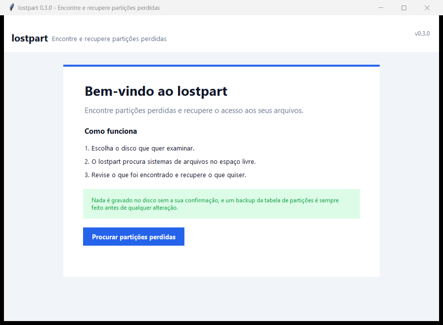
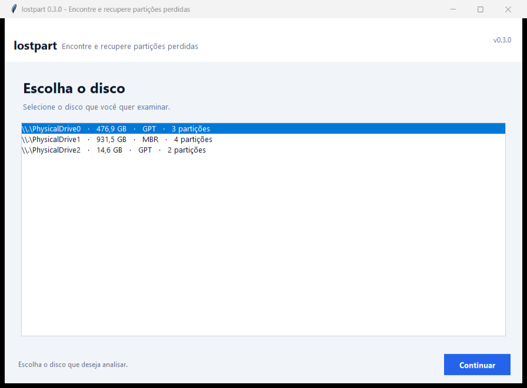
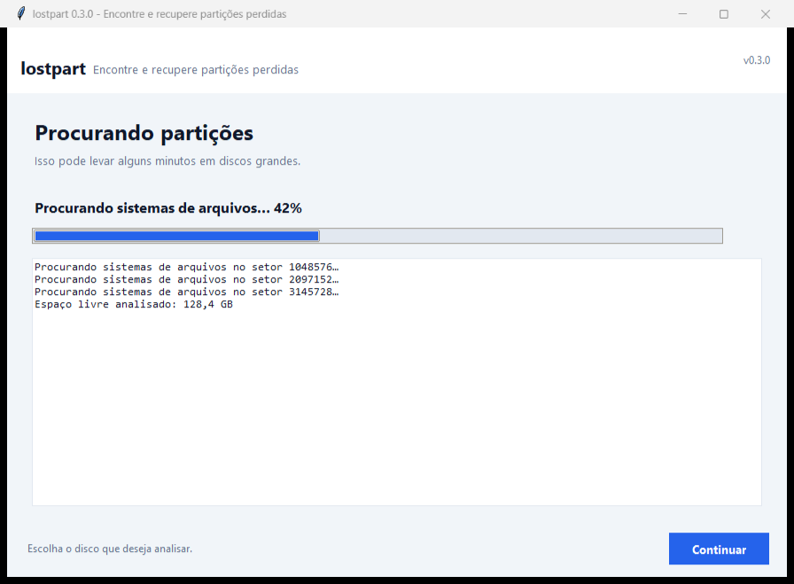
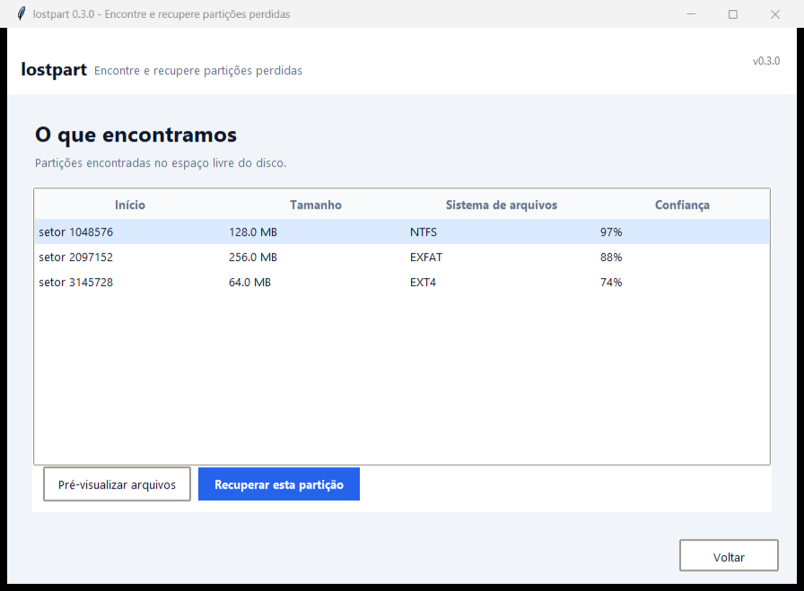
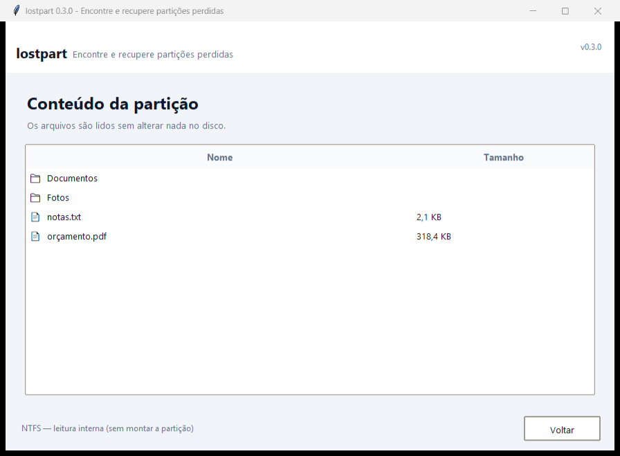
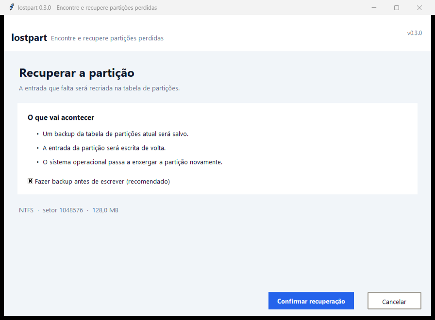
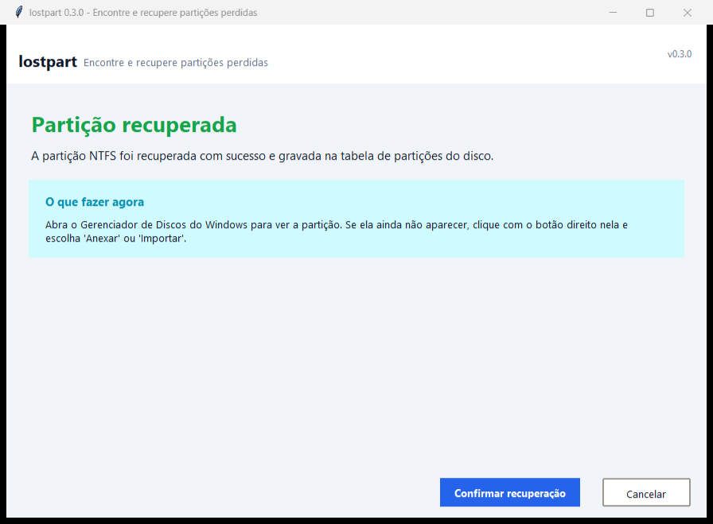
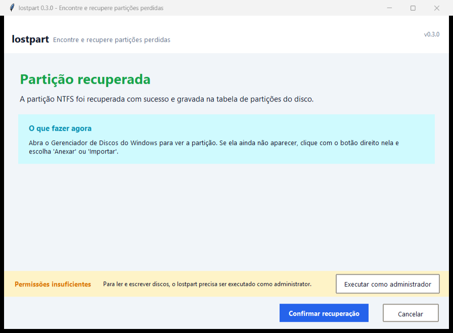

# lostpart

**Encontre e recupere partições perdidas — Windows e Linux.**

O `lostpart` procura sistemas de arquivos que continuam no disco mas
**perderam a entrada na tabela de partições**, e reconstrói essa entrada. É a
ferramenta para quando uma partição some depois de uma repartição, de um
`diskpart` mal executado, de um instalador que sobrescreveu a MBR, ou de um
disco cuja tabela nunca chegou a ser gravada.

A partir da versão **0.3.0** o programa tem **interface gráfica** e fala
**português do Brasil** — inclusive a linha de comando.



---

## Sumário

- [Downloads](#downloads)
- [Como usar (com janela)](#como-usar-com-janela)
- [Como usar (linha de comando)](#como-usar-linha-de-comando)
- [Por que dá para confiar](#por-que-dá-para-confiar)
- [Sistemas de arquivos suportados](#sistemas-de-arquivos-suportados)
- [Plataformas](#plataformas)
- [Segurança](#segurança)
- [Origem do projeto](#origem-do-projeto)
- [Instalação a partir do código](#instalação-a-partir-do-código)
- [Estrutura do projeto](#estrutura-do-projeto)
- [Desenvolvimento](#desenvolvimento)

---

## Downloads

Cada versão publica binários prontos, sem precisar instalar Python:

| Plataforma | Arquivo | Observações |
| --- | --- | --- |
| Windows x64 | `lostpart-installer.exe` | **Recomendado.** Assistente de instalação, sem pedir senha de administrador. |
| Windows x64 | `lostpart-windows-x64.exe` | Portátil, um arquivo só, não instala nada. |
| Linux x64 | `lostpart-linux-x64` | ELF estático `x86_64-linux-musl`. Sem Python e sem libc. |

```bash
chmod +x lostpart-linux-x64
./lostpart-linux-x64 --help
```

O binário do Linux se descompacta em `~/.cache/lostpart/<versão>/` na
primeira execução e reaproveita essa cópia depois. Baixe na
[página de versões](https://github.com/AtamisFilho/testes/releases).

> **Windows:** o executável não é assinado digitalmente, então o Windows
> SmartScreen pode mostrar um aviso. Clique em *Mais informações* → *Executar
> mesmo assim*. Para evitar isso, prefira o instalador. As somas SHA-256 de
> todos os arquivos estão no `SHA256SUMS.txt` de cada versão.

---

## Como usar (com janela)

O jeito mais simples é abrir o programa e clicar. Ele abre uma janela com
sete telas, em português, sem nenhum termo técnico obrigatório.

### 1. Boas-vindas


O botão **Procurar partições perdidas** começa o assistente. O texto verde
explica a única regra importante: **nada é gravado no disco sem a sua
confirmação**, e um backup da tabela de partições é sempre feito antes.

### 2. Escolha o disco



O programa lista os discos do computador com o tamanho, o tipo da tabela
(MBR ou GPT) e quantas partições cada um tem. Escolha com um clique e siga
para a varredura.

### 3. Procurando



A barra de progresso e o registro dizem, em português, o que está acontecendo
em cada momento. Pode levar alguns minutos em discos grandes — a janela nunca
congela, porque a varredura roda em outra thread.

### 4. O que encontramos



Cada partição encontrada aparece com o **setor de início**, o **tamanho**, o
**sistema de arquivos** e a **confiança** da identificação. A confiança vem
das evidências coletadas: em NTFS, por exemplo, o resultado só é considerado
forte quando o mapa de alocação (`$Bitmap`) bate com o conteúdo real do disco.

Dê um duplo clique para ver os arquivos antes de decidir.

### 5. Pré-visualização



Os arquivos são lidos **sem alterar nada** e **sem precisar de administrador**,
porque o lostpart interpreta o sistema de arquivos diretamente em vez de
montar a partição.

### 6. Recuperar



A tela explica, em três linhas, o que vai acontecer. A opção de backup vem
marcada de fábrica, e é recomendado não mexer nela. O botão **Confirmar
recuperação** é o único que escreve no disco.

### 7. Concluído



Depois da recuperação, o programa diz o que fazer a seguir: abrir o
*Gerenciador de Discos* do Windows e, se a partição ainda não aparecer,
anexá-la ou importá-la.

### Permissões



Ler e escrever discos no Windows exige privilégios de administrador. Quando o
programa detecta que eles faltam, mostra essa faixa no rodapé com o botão
**Executar como administrador**, que reabre o lostpart já com a permissão
certa. No Linux, rode como `root` (ou com uma regra de `udev`).

### Abrir a interface gráfica pela linha de comando

```bash
lostpart grafica
```

---

## Como usar (linha de comando)

Quem prefere o terminal continua com tudo disponível. Os comandos têm nome
em português e **também** aceitam o nome em inglês, para que scripts antigos
continuem funcionando.

```bash
lostpart --help
```

```
uso: lostpart [-h] [--version] [-v]
                {listar,list,escanear,scan,recuperar,recover,navegar,browse,
                 backup,restaurar,restore,grafica,gui} ...

Encontre e recupere partições perdidas.

comandos:
  listar (list)       listar discos e tabelas de partições
  escanear (scan)     procurar partições perdidas no espaço livre
  recuperar (recover) recrever a entrada que falta na tabela
  navegar (browse)    ver o conteúdo de uma partição
  backup              salvar a tabela de partições
  restaurar (restore) restaurar uma tabela de partições salva
  grafica (gui)       abrir a interface gráfica
```

### Listar os discos

```bash
lostpart listar
lostpart listar --device 0
lostpart listar --device /caminho/do/disco.img
```

### Procurar partições perdidas

```bash
lostpart escanear --device 0                  # varredura completa do espaço livre
lostpart escanear --device 0 --mode quick      # mais rápida, menos detalhada
lostpart escanear --device 0 --json            # saída legível por máquina
lostpart escanear --device 0 --checkpoint scan.db
```

A varredura olha **apenas o espaço livre** entre as partições conhecidas e
acha candidatos procurando assinaturas de sistema de arquivos em blocos
grandes, validando cada achado. Use `--checkpoint` para guardar um checkpoint
em SQLite e retomar uma varredura interrompida.

Exemplo de saída:

```
Partições encontradas

  Disco         \\.\PhysicalDrive0
  Tabela        MBR
  Modo          completa
  Tempo         12.4s
  Espaço livre  2 região(ões), 931.4 GB analisados
────────────────────────────────────────────────────────────────
  Início   Setores     Tamanho  Sistema de arquivos  Confiança  Como foi identificada
  ───────  ────────  ─────────  ───────────────────  ─────────  ─────────────────────
   1048576   4194304  128.0 MB  NTFS                   97%  assinatura + bitmap de alocação
```

### Ver o conteúdo antes de gravar

```bash
lostpart navegar --device 0 --start 1048576
lostpart navegar --device 0 --start 1048576 --path "Users/ana"
lostpart navegar --device 0 --start 1048576 --json
```

O `navegar` interpreta o sistema de arquivos diretamente, então funciona
**sem escrever no disco** e sem privilégios de administrador.

### Gravar a entrada que falta

```bash
# ensaio: mostra exatamente o que mudaria, sem gravar nada
lostpart recuperar --device 0 --start 1048576 --size 4194304 --fs ntfs

# grava de verdade, fazendo um backup antes
lostpart recuperar --device 0 --start 1048576 --size 4194304 --fs ntfs --apply
```

Sem `--apply` nada é gravado. Com ele, o programa:

1. valida o candidato (não pode sobrepor uma partição existente nem ultrapassar
   o fim do disco);
2. grava um backup das estruturas da tabela em `lostpart-backups/`
   (desligue com `--no-backup`);
3. escreve a entrada — numa vaga livre da MBR, numa cadeia de registros de boot
   estendidos, ou numa vaga livre da GPT, mantendo as duas cópias da GPT e os
   respectivos CRCs consistentes.

### Salvar e restaurar a tabela de partições

```bash
lostpart backup --device 0 --output mbr-backup.json
lostpart restaurar --device 0 --backup mbr-backup.json
```

O backup é JSON puro com os dados em base64, então pode ser inspecionado e
restaurado com ferramentas comuns.

### Menu interativo

Sem comando nenhum, o lostpart abre um menu:

```
lostpart 0.3.0 - encontre e recupere partições perdidas

   1  Listar os discos e suas partições
   2  Procurar partições perdidas em um disco
   3  Ver o conteúdo de uma partição
   4  Salvar a tabela de partições de um disco
   5  Abrir a interface gráfica
   6  Mostrar as opções da linha de comando
   0  Sair
```

---

## Por que dá para confiar

Um sistema de arquivos que por acaso tem os bytes `NTFS    ` em algum lugar
não é uma partição. O lostpart não confia em assinaturas:

- **Todo candidato é analisado por inteiro.** O bloco de parâmetros do BIOS do
  candidato é validado campo a campo — bytes por setor, setores por cluster,
  contagem de clusters, geometria da FAT, superbloco. Um candidato que falha
  na validação é descartado, e o motivo é informado.
- **As bordas do NTFS são provadas pelo mapa de alocação.** O meta-arquivo
  `$Bitmap` de um volume diz exatamente quais clusters estão alocados. O
  lostpart lê esse mapa e confere com os bytes reais do disco: clusters que o
  mapa chama de *alocados* precisam conter dados, e os que ele chama
  *livres* precisam estar zerados. Isso confirma o início do volume e
  determina onde ele termina — o último cluster alocado. Os setores *anteriores*
  ao candidato também são amostrados, para confirmar que não pertencem ao
  volume.
- **Todo veredito vem com as suas evidências.** Os motivos por trás de cada
  candidato são mostrados, para que você possa decidir se confia nele.

---

## Sistemas de arquivos suportados

| Sistema de arquivos | Detecção | Prova dos limites | Navegação |
| --- | --- | --- | --- |
| NTFS | boot sector + BPB | `$Bitmap` conferido com o disco, `$MFT` como contraprova | sim |
| exFAT | boot sector + validação do VBR | comprimento do volume pelo VBR | sim |
| FAT12/16/32 | geometria do BPB + string de tipo | contagem de clusters pelo BPB | sim |
| ext2/3/4 | magic do superbloco + geometria | contagem de blocos pelo superbloco | sim |
| Linux swap | magic e versão do cabeçalho de swap | contagem de clusters pelo cabeçalho | não se aplica (não tem árvore de diretórios) |
| HFS+ | assinatura, versão e magic do volume header | contagem de blocos pelo cabeçalho | melhor esforço |

---

## Plataformas

| | Windows | Linux |
| --- | --- | --- |
| Acesso ao disco | `\\.\PhysicalDriveN` com `DeviceIoControl` | `/dev/sdX` com `ioctl` |
| Tamanho do setor | `IOCTL_DISK_GET_DRIVE_GEOMETRY_EX` | `BLKSSZGET` |
| Montagem nativa | atribuição de letra de unidade | loop mount com deslocamento |

Discos 512e (Advanced Format) e 4Kn são tratados: o tamanho do setor lógico
informado pelo disco é usado em todo o programa, enquanto o
`bytes_per_sector` do próprio sistema de arquivos é usado na aritmética
interna de clusters.

Imagens de disco (`.img`, `.dd`, …) podem ser usadas em qualquer lugar onde
um disco físico seria usado, o que ajuda a testar e a analisar sem risco.

---

## Segurança

- **Nada é gravado sem `--apply`.** Os comandos `recuperar` e `escanear` abrem o
  dispositivo somente para leitura.
- **Um backup é feito antes de cada gravação.**
- **As gravações são validadas antes** — candidatos sobrepostos ou fora dos
  limites do disco são recusados.
- **A GPT é mantida consistente**: os dois vetores de entradas, os dois
  cabeçalhos e todos os CRCs são reescritos juntos.
- **Na interface gráfica**, o botão de confirmação é o único caminho para a
  gravação, e a opção de backup vem ligada.

O acesso direto ao disco exige privilégios elevados no Windows (executar como
administrador) e `root` no Linux.

---

## Origem do projeto

Esta é uma implementação independente, em **clean-room**, escrita a partir das
especificações públicas dos formatos:

| Formato | Referência |
| --- | --- |
| MBR / MBR protetora | layout da tabela de partições do IBM PC |
| GPT | UEFI Specification 2.10, seção 5 |
| NTFS | Microsoft [MS-FSCC] e o layout do volume boot sector do NTFS |
| exFAT | especificação do sistema de arquivos exFAT da Microsoft |
| FAT12/16/32 | especificação [MS-FAT] da Microsoft |
| ext2/3/4 | `Documentation/filesystems/ext2` do Linux |
| Linux swap | `Documentation/admin-guide/uses-of-swapon` |
| HFS+ | Apple TN1150, HFS Plus Volume Format |

Nenhum código proprietário foi copiado. O comportamento foi estudado por
fora — observando o que um gerenciador de partições faz com um disco — e
depois implementado a partir das especificações.

---

## Instalação a partir do código

```bash
pip install .
# ou, para desenvolver
pip install -e ".[dev]"
```

Python 3.12 ou mais novo. Nenhuma dependência de terceiros em tempo de
execução — a interface gráfica usa apenas o Tkinter, que já vem com o Python.

---

## Estrutura do projeto

```
lostpart/
├── constants.py       constantes em disco, por formato
├── device.py          acesso ao disco (Windows, Linux, imagens)
├── errors.py          hierarquia de exceções
├── i18n.py            catálogo de textos em português
├── cli.py             interface de linha de comando
├── interactive.py     menu interativo
├── fs/                sondas e leitores somente-leitura
│   ├── base.py        o contrato de sonda/leitor
│   ├── ntfs.py        boot sector, $MFT, runlists do NTFS
│   ├── exfat.py       exFAT
│   ├── fat.py         FAT12/16/32
│   ├── ext.py         ext2/3/4
│   ├── swap.py        Linux swap
│   ├── hfsplus.py     HFS+
│   └── registry.py    despacho das sondas
├── tables/            leitura e construção de tabelas de partições
│   ├── mbr.py         MBR e a cadeia de EBR
│   ├── gpt.py         GPT, GUIDs, CRC32
│   └── table.py       visão unificada da tabela
├── scan/              busca de partições perdidas
│   ├── unallocated.py cálculo do espaço livre
│   ├── scanner.py     a varredura
│   ├── bitmap_match.py  prova pelo mapa de alocação do NTFS
│   ├── checkpoint.py  checkpoints retomáveis em SQLite
│   └── model.py       registros de candidato e de resultado
├── recover/           gravação da entrada de volta
│   ├── writer.py      escrita de entradas MBR e GPT
│   └── backup.py      backup e restauração
├── browse/            pré-visualização de uma partição recuperada
│   └── lister.py      leitura interna e montagem nativa
├── ui/                interface visual
│   ├── theme.py       paleta, tipografia e estilos
│   ├── console.py     painéis, tabelas e cores no terminal
│   └── app.py         o assistente gráfico em Tkinter
├── scripts/           ferramentas de build e de publicação
│   ├── build.py         monta o binário do Windows, o ELF do Linux e o instalador
│   ├── launcher.c       o launcher ELF estático do build do Linux
│   ├── lostpart_main.py ponto de entrada dos executáveis empacotados
│   ├── make_icon.py     gera o ícone do aplicativo
│   ├── make_test_image.py  gera uma imagem de disco para testes manuais
│   ├── screenshot_gui.py   captura as telas da interface
│   └── verify_release.py confere os artefatos produzidos
├── installer/         o script do Inno Setup para o instalador do Windows
├── assets/            o ícone do aplicativo
├── docs/              notas de versão e capturas de tela
├── tests/             a suíte de testes
├── BUILDING.md        como compilar os binários
└── CHANGELOG.md       o que mudou em cada versão
```

---

## Desenvolvimento

```bash
pip install -e ".[dev]"
python -m pytest
```

A suíte de testes monta imagens de disco sintéticas — setores MBR, discos GPT
com as duas cópias, e um volume NTFS completo com `$MFT` e `$Bitmap` de
verdade — e exercita o scanner, o verificador de bitmap e os escritores
contra elas. **Nenhum disco físico é tocado pelos testes.** Os testes da
interface gráfica são pulados quando não há display disponível.

Para gerar os binários avulsos, veja [BUILDING.md](BUILDING.md).
O [changelog](CHANGELOG.md) lista o que mudou em cada versão.

---

## Licença

MIT — veja [LICENSE](LICENSE).
